<div align="center">

# OpenSplit

**Free, open-source expense splitting for Android. No paid tier. No locked features.**

Split bills with roommates, trips, and friends. Track who owes whom, settle up with the
fewest payments, and bring your own AI key for receipt scanning and natural-language entry.

[](https://github.com/SutharShantanu/OpenSplit/actions/workflows/android.yml)
[](https://github.com/SutharShantanu/OpenSplit/releases/latest)
[](https://github.com/SutharShantanu/OpenSplit/releases)


**[⬇️ Download latest APK](https://github.com/SutharShantanu/OpenSplit/releases/latest)** &nbsp;·&nbsp;
[Nightly build](https://github.com/SutharShantanu/OpenSplit/releases/download/nightly/OpenSplit.apk) &nbsp;·&nbsp;
[All releases](https://github.com/SutharShantanu/OpenSplit/releases)

</div>

---

## Screenshots

<p align="center">
  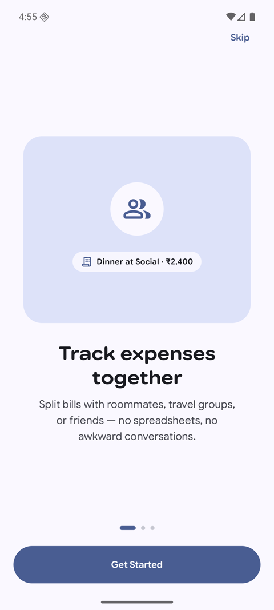
  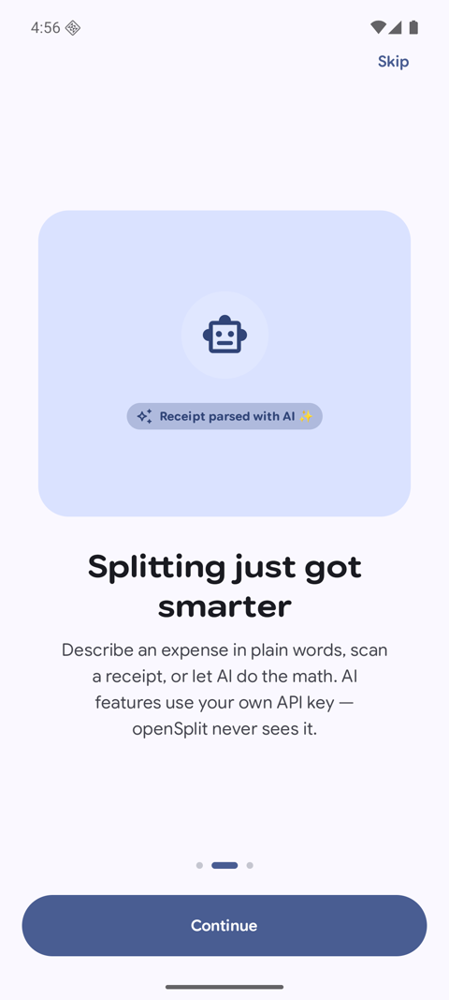
  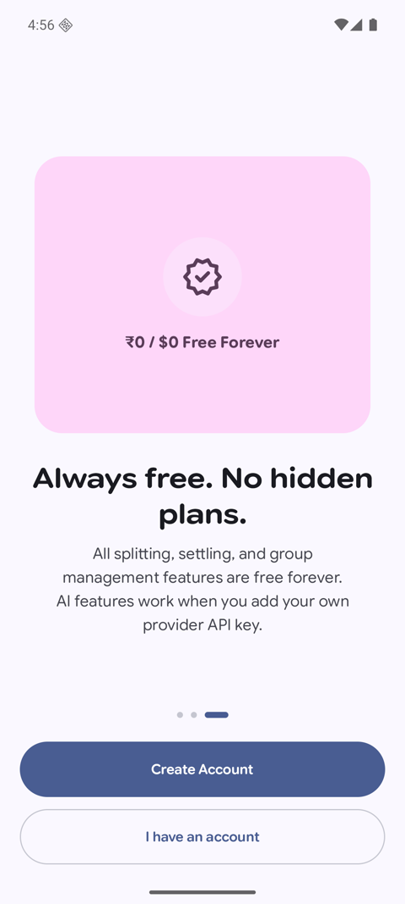
  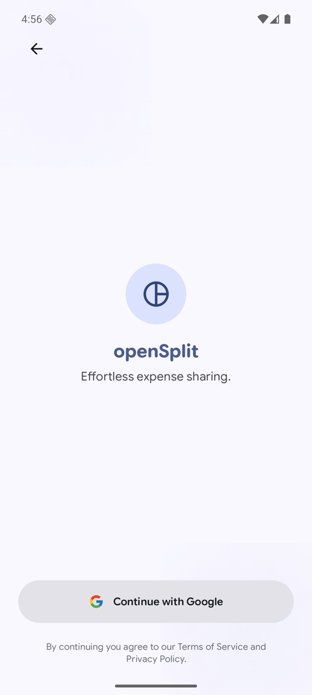
</p>
<p align="center">
  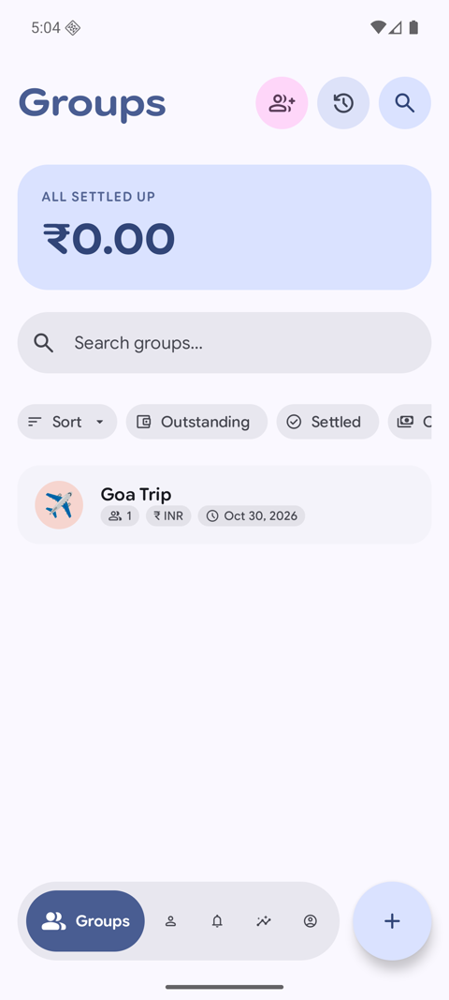
  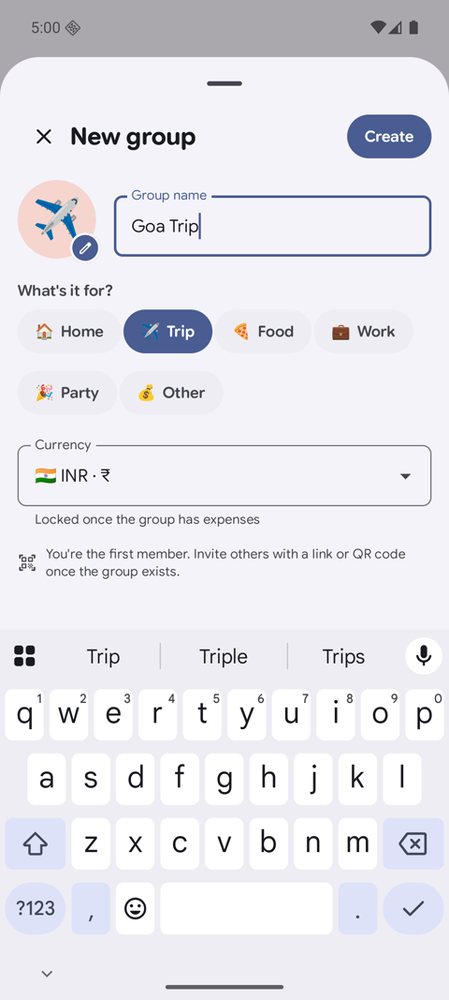
  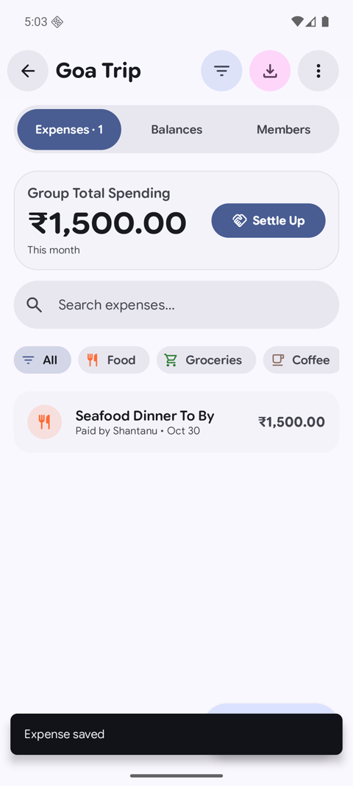
  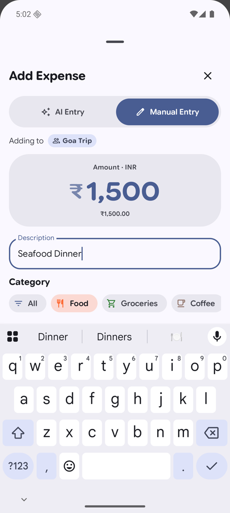
</p>
<p align="center">
  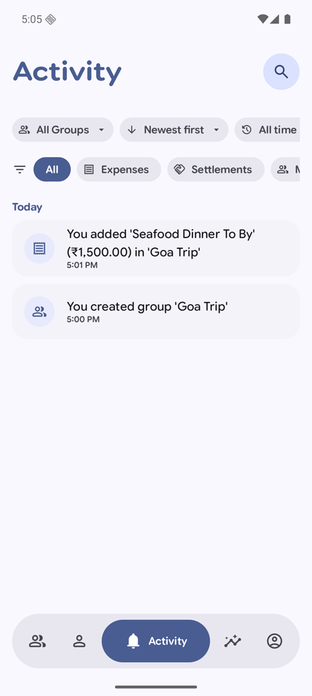
  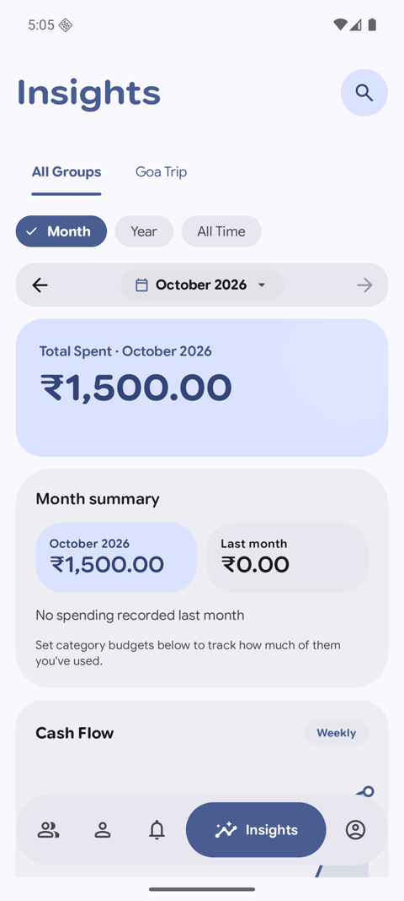
  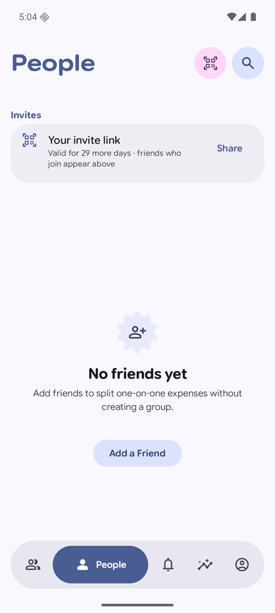
  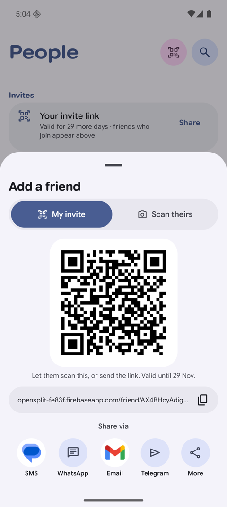
</p>
<p align="center">
  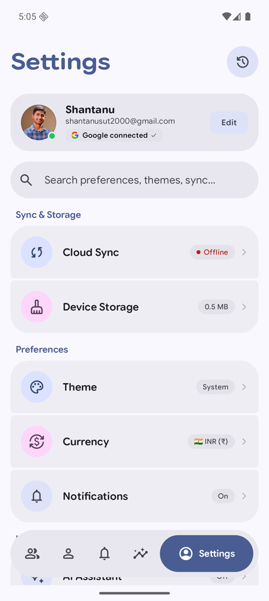
  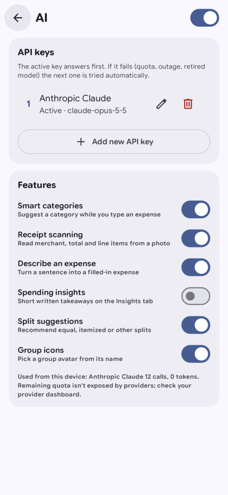
  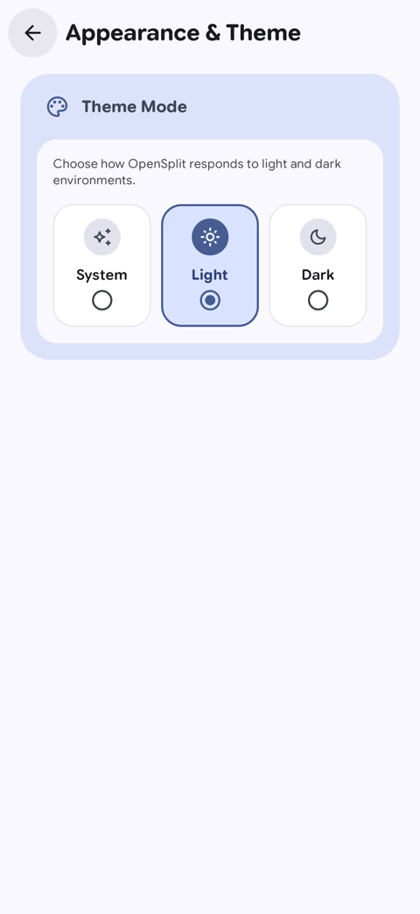
  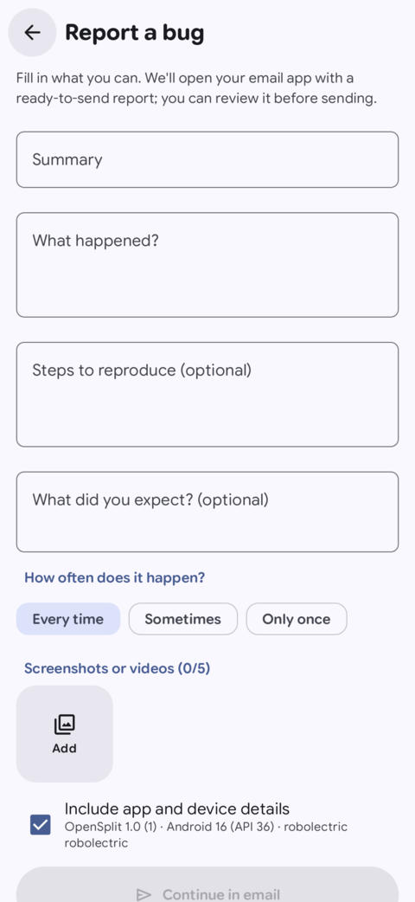
</p>

---

## Install

1. Download `OpenSplit.apk` from the **[latest release](https://github.com/SutharShantanu/OpenSplit/releases/latest)**.
2. Open it on your phone and allow installs from your browser when prompted.
3. Sign in with Google and create or join a group.

Or from a computer with `adb`:

```bash
adb install -r OpenSplit.apk
```

| Channel | What you get | When it updates |
|---|---|---|
| **Release** `vX.Y.N` | Release build, APK + AAB + SHA-256 checksums | Every successful build on `main` |
| **Nightly** | Debug build for testing | Every push to `main` |

> Builds are signed with a stable debug key only when the `DEBUG_KEYSTORE_BASE64` secret is
> set in CI. Without it (or without `GOOGLE_SERVICES_JSON`) the APK installs and the UI works,
> but Google sign-in and cloud sync do not. See [CI/CD](#cicd) below.

---

## Features

### Groups and people
- Groups with emoji, letter, or image avatars. AI suggests an emoji from the name.
- Invite by link or QR code, with expiry (1 hour to never) and optional max uses.
- Fast **Share via** action bar to share invite links via WhatsApp, Telegram, SMS, Email, or system chooser.
- Friend requests, direct 1:1 expenses outside any group, archived groups, pinned groups.
- Group currency locks once the group has expenses. Balances settle **per currency**, never
  summed into a meaningless mixed total.

### Expenses
- Five split modes: **Equal**, **Exact**, **Percentage**, **Shares**, **Itemized** (assign
  receipt line items to people; tax and tip spread proportionally).
- Multiple payers, any subset of participants, categories, notes, receipt photo.
- Recurring bills (weekly to yearly) with pause and resume, created on-device by WorkManager.
- Edit history on every expense. Soft delete with undo and a 90-day **Recently deleted** screen.
- Global search across expenses, payments, groups, and people.

### Settle up
- Debt simplification minimizes the number of payments across the whole group.
- Record settlements by cash, UPI, bank transfer, or other. Full settlement history.
- Reminders to debtors, with rate limiting.

### Insights
- Spend by category, cash flow over time, top people and groups.
- Per-category monthly budgets with progress.
- Export to CSV, JSON, or PDF.

### AI, bring your own key
Claude, OpenAI, Gemini, Groq, Mistral, DeepSeek, or any OpenAI-compatible endpoint. Keys are
stored encrypted on the device and never leave it except to call the provider you chose.

- Receipt scanning that streams fields into the expense form.
- Natural-language entry: "Rahul paid 1500 for dinner yesterday, split with me and Priya".
- Smart categories, group icon suggestions, spending insights.
- Every AI feature has a per-feature switch and an offline fallback.

### Experience
- 100% Jetpack Compose, Material 3 Expressive, Material Symbols Rounded.
- System / Light / Dark themes with Material You colors (Sage fallback on grey wallpapers).
- Floating navigation bar with expressive animated pill indicators and docked quick actions.
- In-app updates: checks GitHub Releases directly, displays release notes, and triggers the installer.
- Built-in **Report a bug** screen with automatic device diagnostics (app version, Android release, device manufacturer/model).
- Navigation rail and list-detail layouts on tablets. Home screen widgets.
- Offline-first: Firestore local persistence keeps everything usable without a connection.

---

## How it works

### Settling with the fewest payments

Raw balances after a trip often form a web of small debts. `DebtSimplifier` nets them so
each person makes at most one or two transfers.

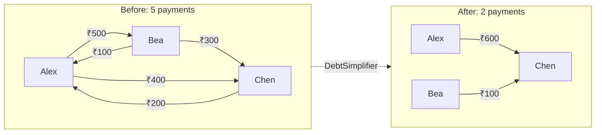

### Architecture

Plain MVVM over three layers. ViewModels never touch Firebase directly.

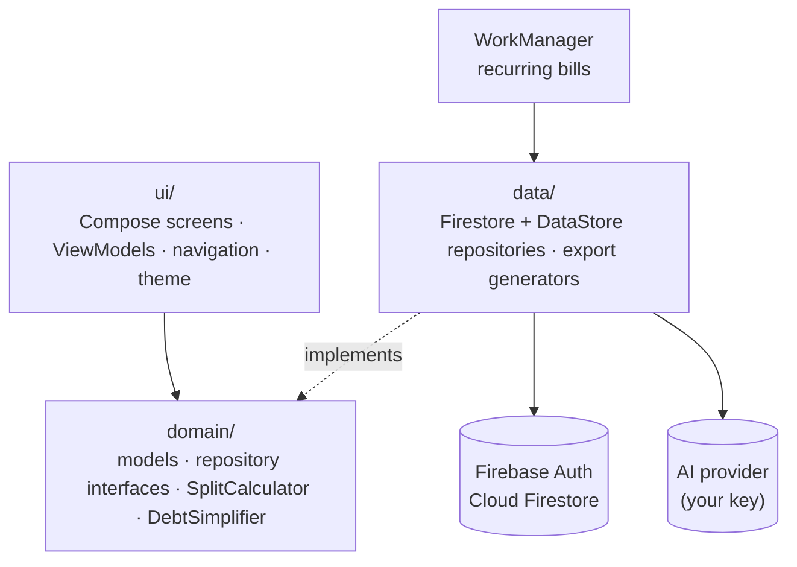

```
app/src/main/java/com/opensplit/
  domain/   models, repository interfaces, pure logic (SplitCalculator, DebtSimplifier)
  data/     Firebase and DataStore implementations, export generators
  di/       AppContainer (manual DI)
  ui/       screens, viewmodels, navigation, theme, components
  widget/   home screen widgets
  util/     CurrencyFormatter and helpers
```

---

## Roadmap

Planned, roughly in order. Open an issue to vote or claim one.

- [ ] **Guests**: add a named person who does not use the app; a claim link lets them take
      over their balance later.
- [ ] **Offline drafts**: queue expenses while offline and review them in one batch.
- [ ] **Approximate currency conversion** display using a cached daily rate (never used for
      balances).
- [ ] **Comments** under each expense.
- [ ] **App lock** with biometrics.
- [ ] **Localization** beyond English.
- [ ] **F-Droid** and Play Store listings.

Done recently: In-app GitHub updates, in-app bug reporting with diagnostics, unified share bar, Android 17 widgets, QR invites, recurring bills, multi-provider AI, tablet layouts, edit history, recently deleted, budgets.

---

## Tech stack

| Area | Choice |
|---|---|
| Language | Kotlin 2.2 |
| UI | Jetpack Compose, Material 3 Expressive |
| Architecture | MVVM, domain / data / ui layers |
| DI | Manual (`di/AppContainer`) |
| Backend | Firebase Auth + Cloud Firestore (offline persistence on) |
| Preferences | DataStore, EncryptedSharedPreferences for AI keys |
| Async | Coroutines + Flow |
| Background | WorkManager |
| Images | Coil |
| Tests | JUnit4, Robolectric, Roborazzi screenshots |

---

## Build it yourself

Full guide: **[docs/SETUP.md](docs/SETUP.md)**.

```bash
# 1. Put your Firebase config at app/google-services.json
# 2. Optional: .env with GEMINI_API_KEY=... (see .env.example)
./gradlew :app:assembleDebug
./gradlew :app:testDebugUnitTest
```

Google sign-in needs the SHA-1 of your signing key registered in the Firebase project:

```bash
scripts/print-debug-sha1.sh
```

---

## CI/CD

Two GitHub Actions workflows. Android cannot be built on web hosts like Vercel or Netlify;
all APKs come from Actions.

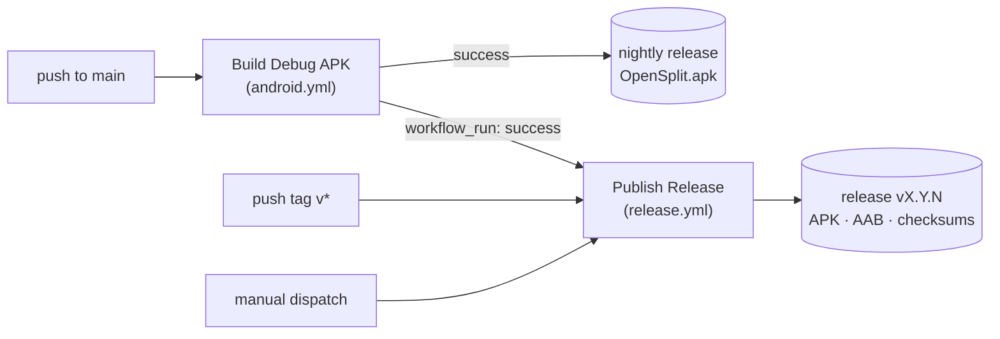

- **`android.yml`**: builds a debug APK on every push to `main`, uploads it as an artifact,
  and recreates the rolling `nightly` release so its date and tag track the current commit.
- **`release.yml`**: runs after a successful main build (or on a `v*` tag / manual dispatch),
  builds release APK + AAB, writes SHA-256 checksums, and publishes a versioned release
  `v<versionName>.<run_number>` with generated notes.

### Secrets

Set under **Settings → Secrets and variables → Actions**.

| Secret | Purpose | If missing |
|---|---|---|
| `GOOGLE_SERVICES_JSON` | `base64 -w0 app/google-services.json` | Placeholder config; sign-in and sync disabled |
| `DEBUG_KEYSTORE_BASE64` | `base64 -w0 debug.keystore`; stable SHA-1 for Google sign-in | Throwaway key per build; Google sign-in fails |
| `GEMINI_API_KEY` | Optional default Gemini key | Empty |
| `RELEASE_KEYSTORE_BASE64`, `STORE_PASSWORD`, `KEY_ALIAS`, `KEY_PASSWORD` | Real release signing | Falls back to the debug keystore |

---

## Contributing

See **[CONTRIBUTING.md](CONTRIBUTING.md)**. Short version: keep it free, Material 3 only,
respect the layers, and add tests when you touch money math.

## License

Open source. A `LICENSE` file is still to be chosen before wider distribution.
