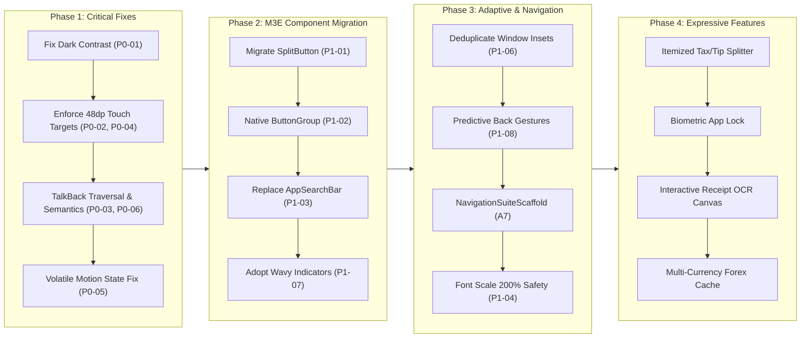

# 11 — Engineering Implementation Roadmap & Rollout Plan

This document details the 4-phase technical roadmap for resolving all identified audit findings and achieving complete Material 3 Expressive compliance across the OpenSplit codebase.

---

## 1. Roadmap Overview & Phased Milestones

---

## 2. Phase 1: Accessibility Fixes & P0 Blockers (Week 1–2)

### Goal: Eliminate all WCAG 2.2 AA violations, accessible touch target failures, and screen reader blind spots.

- [ ] **M3E-P0-01: Financial Contrast Tokens**
  - Define `ColorScheme.financialPositive` and `ColorScheme.financialNegative` in `Theme.kt`.
  - Replace static `OpenSplitTokens.OwedPositive` and `OwedNegative` across `HeroBalanceMotif.kt`, `GroupsScreen.kt`, and `FriendsScreen.kt`.
  - Verify dark mode contrast meets 4.5:1.
- [ ] **M3E-P0-02 & P0-04: Touch Target Enforcement**
  - Update `AddExpenseScreen.kt:1090` share buttons from 36dp to 48dp (`size(48.dp)`).
  - Update `HeroBalanceMotif.kt:176` balance rows with `defaultMinSize(minHeight = 48.dp)`.
  - Update `AccountScreen.kt:682` edit button with `minimumInteractiveComponentSize()`.
- [ ] **M3E-P0-03 & P0-06: TalkBack Hierarchy & Semantics**
  - Set `isTraversalGroup = true` and `traversalIndex = -1f` on `FloatingNavBar.kt`.
  - Include all categories in `DonutChart` semantics in `AnalyticsScreen.kt:802`.
  - Add `role = Role.Button` to the swap direction pill in `SettleUpScreen.kt:281`.
- [ ] **M3E-P0-05: Volatile Motion State Reactive Refactor**
  - Hoist `LocalReduceMotion` to be consumed directly in `MainNavHost` enter/exit transition lambdas.

**Verification Gate 1**:
- Automated Roborazzi screenshot test run in Dark Theme.
- TalkBack traversal run with accessibility scanner showing 0 touch target warnings (< 48dp).

---

## 3. Phase 2: M3 Expressive Core Component Migration (Week 3–4)

### Goal: Replace deprecated M3 APIs, custom simulated controls, and fake search bars with stable Material 3 Expressive components.

- [ ] **M3E-P1-01: SplitButton Adoption**
  - Create `ui/components/SplitButtonActions.kt`.
  - Replace deprecated `SplitButtonLayout` in `GroupDetailScreen.kt:237` with `SplitButton`.
  - Add `SplitButton` for expense export in `AnalyticsScreen.kt` (PDF / CSV / JSON).
- [ ] **M3E-P1-02: Native ButtonGroup**
  - Refactor `HeaderButtonGroup` in `HeaderAction.kt:48` to use `androidx.compose.material3.ButtonGroup`.
  - Replace split mode toggle row in `AddExpenseScreen.kt:1008` with `ConnectedButtonGroup`.
- [ ] **M3E-P1-03: Native SearchBar Migration**
  - Replace `AppSearchBar.kt` with `androidx.compose.material3.SearchBar` in `MainDashboard.kt` and `GlobalSearchSheet.kt`.
  - Implement full-screen expanding search transition with predictive back dismissal.
- [ ] **M3E-P1-07: WavyProgressIndicator**
  - Replace static `Box` ratio bar in `HeroBalanceMotif.kt:250` with `LinearWavyProgressIndicator`.
  - Add `WavyProgressIndicator` to budget tracking in `AnalyticsScreen.kt`.
- [ ] **M3E-P2-02: FAB Menu Standardization**
  - Standardize `ActionFabMenu` across `GROUPS`, `PEOPLE`, and `INSIGHTS` tabs on `MainDashboard.kt`.

**Verification Gate 2**:
- Zero compiler deprecation warnings for `SplitButtonLayout` or `SegmentedButton`.
- Component interaction tests confirming shape morphing on press and selection.

---

## 4. Phase 3: Adaptive Layouts & Predictive Back (Week 5–6)

### Goal: Refine Android system integration, deduplicate window insets, support Android 14+ Predictive Back, and secure 200% font scaling.

- [ ] **M3E-P1-06: Window Inset Deduplication**
  - Audit all `Scaffold` and `WindowInsets` paddings.
  - Remove double bottom inset consumption between `MainDashboard.kt` and child screens.
  - Implement smooth IME keyboard animation in `AddExpenseScreen.kt`.
- [ ] **M3E-P1-08: Predictive Back Gesture Integration**
  - Wire Compose 1.8+ predictive back progress to `NavHost` transitions in `OpenSplitNavGraph.kt`.
  - Test edge-swipe back navigation preview on Android 14 and 15 physical devices.
- [ ] **A7: NavigationSuiteScaffold Refactor**
  - Replace hardcoded `screenWidthDp >= 600` check with `NavigationSuiteScaffold`.
  - Automatically switch between `NavigationBar` (phones), `NavigationRail` (tablets / foldables in portrait), and `NavigationDrawer` (large desktop displays).
- [ ] **M3E-P1-04 & P1-05: Font Scaling & Distortion Fixes**
  - Remove `scaleX = 1.3f` from `Type.kt`. Use `FontVariation.width(115f)` for wide numbers.
  - Wrap `HeroBalanceMotif.kt` currency text in `AccessibleMoneyText` with non-truncating 200% scale safety.

**Verification Gate 3**:
- Tablet emulator (1200x1920) and foldable emulator testing with active hinge folding.
- System font scale set to 2.0x (200%) with 0 text clippings.

---

## 5. Phase 4: Expressive Polish & Advanced Workflows (Week 7–8)

### Goal: Deliver high-value product differentiation features matching top-tier fintech benchmarks.

- [ ] **Itemized Tax & Tip Proportional Calculator**
  - Implement tax and tip percentage selector in `AddExpenseScreen.kt:1107`.
  - Automatically distribute tax/tip across participant splits based on subtotal weight.
- [ ] **Biometric App Lock & Privacy Shield**
  - Integrate `androidx.biometric:biometric:1.4.0` in `SecuritySettingsSubScreen.kt`.
  - Add app lock toggle requiring biometric authentication on resume.
- [ ] **Interactive Receipt Bounding-Box OCR Visualizer**
  - Draw bounding boxes on receipt images parsed by AI in `AddExpenseScreen.kt`.
  - Allow users to tap boxes to claim items for specific members.
- [ ] **Multi-Currency Offline Exchange Rates**
  - Implement cached daily exchange rates repository.
  - Add unified net balance conversion in `HeroBalanceCard`.

**Verification Gate 4**:
- Complete end-to-end receipt scan, split, settlement, and export cycle.
- Final M3 Expressive audit score reassessment targeting > 9.5/10 across all dimensions.
